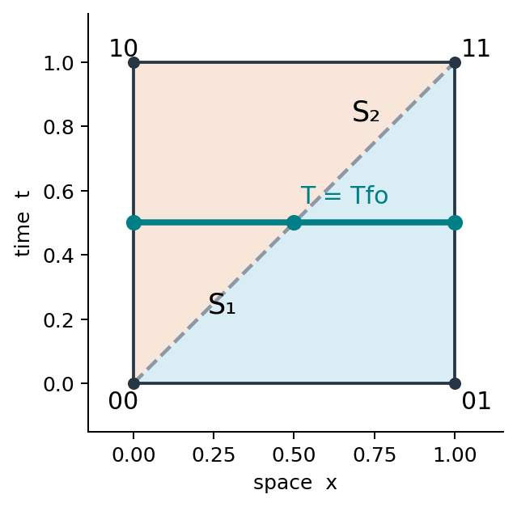
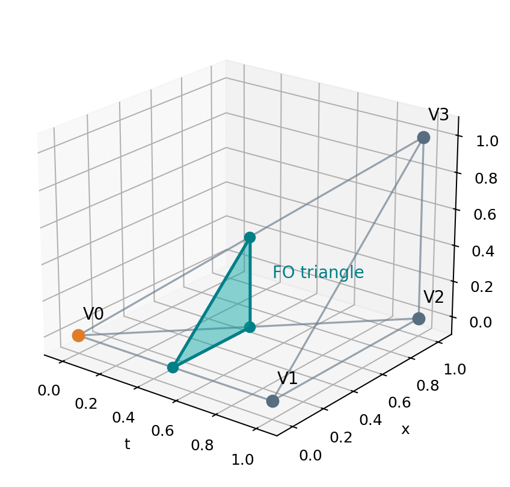

# Simplicial freeze-out: detailed geometry and a guided tour of the Julia code

**Standalone technical notes for a Cartesian spacetime grid**  
**Companion source:** `SimplicialFreezeOut.jl` (fully commented), `walkthrough.jl`, `test_simplicial_freezeout.jl`.

## 1. What problem does the code solve?

We are given a temperature array on a Cartesian-product spacetime grid,

\[
T_{i_0 i_1\cdots i_d}=T(t_{i_0},x^1_{i_1},\ldots,x^d_{i_d}),
\quad D=d+1\in\{2,3,4\}.
\]

We need the codimension-one isothermal set
\(\Sigma=\{X:T(X)=T_{\mathrm{fo}}\}\), together with the oriented hypersurface elements entering a Cooper--Frye or conserved-current integral. The algorithm **does not compute particle spectra**; it returns a list of small geometric elements and sampled hydrodynamic fields.

The word *simplex* refers to a spacetime cell used **to search for** the surface, not to the surface itself. In \(D\) spacetime dimensions, the grid cell is decomposed into \(D\)-simplices; their intersections with the isotherm are \((D-1)\)-dimensional surface pieces.

| Spatial dimensions \(d\) | Spacetime coordinates | Cartesian spacetime cell | Reference decomposition | Output surface piece |
|:--:|:--|:--|:--|:--|
| 1 | \((t,x)\) | rectangle, 4 corners | 2 triangles, 3 vertices each | line segment, 2 endpoints |
| 2 | \((t,x,y)\) | cube, 8 corners | 6 tetrahedra, 4 vertices each | triangle, 3 vertices |
| 3 | \((t,x,y,z)\) | 4D hypercube, 16 corners | 24 four-simplices, 5 vertices each | tetrahedron, 4 vertices |

A tetrahedron in \((t,x,y)\) is a **spacetime volume simplex**; a tetrahedron in \((t,x,y,z)\) is a **freeze-out hypersurface element**. These are different roles.

## 2. Two separate decisions, not one

**Step A: geometrical decomposition.** Every Cartesian cell is cut into a fixed set of \(D!\) reference simplices, independent of temperature. We process **all** of them. There is no question of selecting one favorite simplex.

**Step B: temperature-dependent selection.** For each simplex, examine the signs of \(F_a=T_a-T_{\rm fo}\) at its \(D+1\) vertices. If all signs agree, the affine temperature inside cannot intersect \(F=0\); skip it. Otherwise use a precomputed lookup table to identify the crossing edges and how to connect their intersection points.

At a fixed resolution, this constructs the isotherm of the **piecewise-affine reconstructed temperature field**, which need not coincide exactly with the physical continuum isotherm.

## 3. How the Freudenthal decomposition is generated

Normalize the coordinate cell to \([0,1]^D\), with coordinates \(s=(s_1,\ldots,s_D)\) and \(s_1\) representing time. Let \(e_k\) be the coordinate unit vectors. For each permutation \(\pi=(\pi_1,\ldots,\pi_D)\), define

\[
V_0=0,\qquad V_j=\sum_{k=1}^{j}e_{\pi_k},\quad j=1,\ldots,D.
\]

The \(D+1\) vertices define one simplex. Each permutation gives one monotone staircase from \((0,\ldots,0)\) to \((1,\ldots,1)\). The \(D!\) staircases partition the unit cell without overlapping interiors. They agree across Cartesian cell faces if every cell uses the same convention.

The reference vertices are represented by **bit-coded corner IDs**. In Julia's one-based indexing, the corner with bits \((b_1,\ldots,b_D)\) has index

\[
\operatorname{corner}(b)=1+\sum_{\mu=1}^{D}b_\mu 2^{\mu-1}.
\]

Thus in \(D=3\), \(000\mapsto1\), \(100\mapsto2\), \(010\mapsto3\), and \(111\mapsto8\).

### 3.1 Example in one spatial dimension

The spacetime rectangle \((t,x)\in[0,1]^2\) is cut along the \(00\to11\) diagonal into

\[
S_1=(00,10,11),\qquad S_2=(00,01,11).
\]

Each triangle can contribute one freeze-out **segment**.

{width=68%}

### 3.2 Example in two spatial dimensions

One spacetime cube \((t,x,y)\in[0,1]^3\) has six tetrahedra, obtained by permuting the coordinate order:

| Increment order | Corner bit strings |
|:--|:--|
| \(t,x,y\) | \(000,100,110,111\) |
| \(t,y,x\) | \(000,100,101,111\) |
| \(x,t,y\) | \(000,010,110,111\) |
| \(x,y,t\) | \(000,010,011,111\) |
| \(y,t,x\) | \(000,001,101,111\) |
| \(y,x,t\) | \(000,001,011,111\) |

Each tetrahedron is checked separately. A one-hot/three-cold cut gives one triangle. A two-hot/two-cold cut gives a quadrilateral, divided into two triangles.

{width=70%}

### 3.3 Example in three spatial dimensions

The 4D cell \((t,x,y,z)\in[0,1]^4\) has \(4!=24\) four-simplices. For the order \((t,x,y,z)\), one is

\[
(0000,1000,1100,1110,1111).
\]

Every 4-simplex has five vertices and ten edges. An isotherm cuts it in a **three-dimensional** polytope: either a tetrahedron (1-vs-4 signs) or a prism-like polytope (2-vs-3 signs), subdivided into three freeze-out tetrahedra. The remaining 23 coordinate permutations are constructed automatically, not hand-coded.

## 4. Code map: what every component represents

The top-level structures in `SimplicialFreezeOut.jl` are:

```julia
struct RefSimplex{D,C}
    corners::C                   # D+1 bit-coded reference-cube corner IDs
    gradient_map::Matrix{Float64}  # maps vertex temperature differences to grad_s(T)
end

struct ReferenceGrid{D}
    simplices::Vector{RefSimplex{D}}
    cases::Vector{Vector{NTuple{D,Edge}}}
end

struct SurfaceElement{D,F}
    vertices::NTuple{D,NTuple{D,Float64}}
    centroid::NTuple{D,Float64}
    dsigma::NTuple{D,Float64}
    fields::F
end
```

`RefSimplex` is an **input geometry object**. `ReferenceGrid` holds all the precomputed input simplices and sign-case topology. `SurfaceElement` is an **output geometry object**: in \(D=4\) it contains four isothermal crossing points forming one freeze-out tetrahedron.

The array `cases[mask+1]` contains **edge tuples**, not positions; edge \((a,b)\) refers to local simplex vertices \(a,b\). The points on these edges are evaluated at runtime.

## 5. Precomputation: `_reference_simplices` and `precompute`

The function `_permutations(collect(1:D))` enumerates the \(D!\) coordinate orders. `_reference_simplices(Val(D))` walks from \(0\) to \(1\) in each order, stores the bit-coded corner IDs, and constructs

\[
B_{\mu a}=V_{a+1}^{\mu}-V_1^{\mu},\qquad a=1,\ldots,D.
\]

For an affine temperature \(T_h(s)=T_1+g_\mu(s^\mu-V_1^\mu)\), we have

\[
\begin{pmatrix}T_2-T_1\\ \vdots\\T_{D+1}-T_1\end{pmatrix}
=B^T g,
\qquad g=(B^T)^{-1}\Delta T.
\]

The code stores `(B')^-1` in `gradient_map` **once**. On a physical cell, divide \(g_\mu\) by the coordinate cell width \(h_\mu\) to recover \(\partial T/\partial X^\mu\).

`precompute(Val(D))` then enumerates all hot/cold masks. There are \(2^{D+1}\) possible assignments: 8, 16, and 32 in \(D=2,3,4\), respectively.

```julia
reference = precompute(Val(3))  # D=3 -> 2 spatial dimensions, 6 tetrahedra
reference = precompute(Val(4))  # D=4 -> 3 spatial dimensions, 24 4-simplices
```

Compute `reference` once and reuse it across all cells and solver steps.

## 6. Precomputing the intersection topology: `_case_for_mask`

A temperature mask records only which vertices are hot. For \(D+1\) vertices,

\[
\mathrm{mask}=\sum_{a=1}^{D+1}\mathbf1_{T_a\ge T_{\rm fo}}\,2^{a-1}.
\]

For \(D=3\), take local vertices 1,2 hot and 3,4 cold. There are four hot-cold crossing edges:

\[
P_{00}=(1,3),\quad P_{01}=(1,4),\quad
P_{10}=(2,3),\quad P_{11}=(2,4).
\]

The intersection is a quadrilateral; the precomputed two-triangle pattern is

\[
(P_{00},P_{01},P_{11}),\qquad(P_{00},P_{11},P_{10}).
\]

The symbols \(P_{ij}\) here are **names of edges**. They do not become points until we insert actual temperatures.

For \(D=4\), take local vertices 1,2 hot and 3,4,5 cold. Six crossing edges form a prism. Define \(A_i=(1,i+3)\) and \(B_i=(2,i+3)\) for \(i=0,1,2\). Three output tetrahedra are:

\[
(A_0,A_1,A_2,B_2),\quad
(A_0,A_1,B_1,B_2),\quad
(A_0,B_0,B_1,B_2).
\]

This convention fixes the prism diagonals. Face conformity should be checked when combining neighboring simplices, particularly in degenerate cases.

## 7. Runtime: from one grid cell to actual crossing points

The central function is

```julia
extract_isosurface(temperature, axes, Tfo;
    fields=NamedTuple(), reference=precompute(Val(ndims(temperature))))
```

The first array dimension is time. `axes` is a tuple of strictly increasing physical coordinate arrays. A 2+1D example uses `T[it,ix,iy]` and `(t,x,y)`; 3+1D uses `T[it,ix,iy,iz]` and `(t,x,y,z)`.

The outer loop visits spacetime cells. For each cell, `lows` holds the low coordinate of every axis and `widths` its size; `corner_temp` stores all \(2^D\) corner temperatures. If the entire cell is above or below \(T_{\rm fo}\), it can be skipped immediately.

Otherwise, the program iterates over **all** reference simplices of that cell:

```julia
for template in reference.simplices
    Tverts = ntuple(a -> corner_temp[template.corners[a]], D+1)
    mask = sum((Tverts[a] >= Tfo ? 1 : 0) << (a-1) for a in 1:D+1)
    patterns = reference.cases[mask+1]
    isempty(patterns) && continue
    # Locate the crossing on each edge of every output surface element.
end
```

For edge \((a,b)\) with opposite signs, calculate

\[
\theta_{ab}=\frac{T_{\rm fo}-T_a}{T_b-T_a},\qquad
Y_{ab}=X_a+\theta_{ab}(X_b-X_a).
\]

This is the **only geometric interpolation used in the piecewise-linear algorithm**. The point \(Y_{ab}\) lies on the isotherm of the affine temperature field.

Inside a cell, the normalized reference coordinate \(s\) is converted to physical coordinates through \(X^\mu=L^\mu+h_\mu s^\mu\). This works on nonuniform Cartesian-product axes because each cell has its own widths.

## 8. Worked 2+1D example, with actual numbers

Consider one reference tetrahedron

\[
V_1=(0,0,0),\ V_2=(1,0,0),\ V_3=(1,1,0),\ V_4=(1,1,1).
\]

Let the signed temperatures \(F_a=T_a-T_{\rm fo}\) be

\[
(F_1,F_2,F_3,F_4)=(0.6,0.2,-0.4,-0.2).
\]

Vertices 1,2 are hot; 3,4 are cold. Four edges cross the isotherm. Their crossing fractions are

\[
\theta_{13}=0.6/(0.6+0.4)=0.6,\quad
\theta_{14}=0.6/(0.6+0.2)=0.75,
\]

\[
\theta_{23}=0.2/(0.2+0.4)=1/3,\quad
\theta_{24}=0.2/(0.2+0.2)=1/2.
\]

Thus the intersection points are

\[
P_{13}=(0.6,0.6,0),\quad P_{14}=(0.75,0.75,0.75),
\]
\[
P_{23}=(1,1/3,0),\quad P_{24}=(1,1/2,1/2).
\]

The quadrilateral \((P_{13},P_{14},P_{24},P_{23})\) is divided into two triangles. Their oriented area covectors will be computed and summed. No global point sorting or spline fitting is needed.

**Simplest planar test.** Let \(F=\tfrac12-t\) on a unit cube. The six spacetime tetrahedra together reconstruct the plane \(t=\tfrac12\). The sum over all freeze-out triangles satisfies

\[
\sum_{K}\Delta\sigma_{\mu,K}=(1,0,0),
\]

because the hot region is at \(t<1/2\). The analogous one-cell result is \((1,0)\) for \(D=2\) and \((1,0,0,0)\) for \(D=4\).

## 9. Computing and orienting `dsigma`: `_area_covector`

Each output surface \((D-1)\)-simplex has **D** vertices \(Y_1,\ldots,Y_D\) and \(D-1\) tangent edges \(e_a=Y_{a+1}-Y_1\). The integrated coordinate-oriented hypersurface covector is

\[
\boxed{\displaystyle
\Delta\sigma_\mu=\frac1{(D-1)!}
\epsilon_{\mu\nu_1\cdots\nu_{D-1}}
 e_1^{\nu_1}\cdots e_{D-1}^{\nu_{D-1}}.}
\]

The code computes these components through signed determinants of the \((D-1)\times(D-1)\) minors of the tangent matrix. The initial sign depends on how the vertices were ordered.

An affine temperature has a constant coordinate gradient \(g_\mu=\partial_\mu T_h\) within the input spacetime simplex. The code flips the output orientation, if needed, to have

\[
\sum_\mu\Delta\sigma_\mu g_\mu\le0,
\]

where this last dot product is used **only as a coordinate-based sign test**, not as a Lorentzian contraction. In words, the coordinate-oriented hypersurface covector points toward colder temperature.

To convert a coordinate hypersurface element to the physical one in Milne coordinates, include \(\sqrt{-g}=\tau\) in the **quadrature measure**. The module's `dsigma` does not include this factor.

## 10. Interpolating hydrodynamic fields at the centroid

The output geometry has a centroid
\(X_c=\frac1D\sum_{k=1}^{D}Y_k\). A scalar or vector field is reconstructed affinely from the original spacetime simplex corners, using barycentric weights.

If \(Y_k=(1-\theta_k)V_{a_k}+\theta_kV_{b_k}\), the centroid weights are

\[
w_a=\frac1D\sum_{k=1}^D\big[(1-\theta_k)\mathbf1_{a=a_k}
+\theta_k\mathbf1_{a=b_k}\big].
\]

Then \(q(X_c)=\sum_a w_a q(V_a)\) for an affine field. In the code, `weights` is accumulated within the edge-crossing loop; `_fields_at_centroid` applies the same weights to each supplied array. The surface temperature itself is not returned among `fields` unless it is explicitly supplied.

The centroid is only a quadrature approximation for nonlinear Cooper--Frye integrands. Additional surface quadrature points can be added later, while retaining exactly the same topology.

## 11. `integrate_surface`: geometry versus physics

```julia
integrate_surface(elements,
    e -> sum(J[mu]*e.dsigma[mu] for mu in 1:D);
    measure = x -> 1.0)
```

Here `e.dsigma` is an **integrated coordinate area covector**, so do **not** multiply again by the segment length, triangle area, or tetrahedron volume. The function `integrand(e)` should contract a current with `e.dsigma` and use `e.fields` as needed. `measure(x)` is the coordinate metric-volume density, e.g. `x -> x[1]` for Milne coordinates when the first coordinate is \(\tau\).

For particle spectra, \(p^\mu\Delta\sigma_\mu f(X_c,p)\) is multiplied by the correct phase-space normalization, quantum distribution, viscous corrections, and metric factor. Those physical factors are deliberately outside this geometry-only module.

## 12. How to run the code, step by step

```bash
julia walkthrough.jl                 # explains all D=2,3,4 reference cases
julia demo.jl                        # example smooth temperature profiles
julia test_simplicial_freezeout.jl   # built-in geometry checks
```

In `walkthrough.jl`, a single unit cell is filled with \(T(t)=1.5-t\), with \(T_{\rm fo}=1\). The exact isotherm is \(t=0.5\). It prints every simplex, its hot/cold mask, the number of output pieces, and checks the sum of the oriented hypersurface vectors against \((1,0,\ldots,0)\). The test also samples an affine scalar field at surface centroids.

To use a real grid, call

```julia
include("SimplicialFreezeOut.jl")
using .SimplicialFreezeOut

ref = precompute(Val(4))
surface = extract_isosurface(T, (t,x,y,z), Tfo;
    fields=(ux=ux, uy=uy, uz=uz), reference=ref)

for e in surface
    X = e.centroid       # (t,x,y,z)
    normal_area = e.dsigma  # coordinate-area covector
    u = e.fields         # sampled velocity components
end
```

If a method-of-lines integrator generates time slices sequentially, pass an array with only two consecutive time slices (shape \((2,n_x,n_y,n_z)\)) and their two time coordinates. Repeat on each time interval and append the results. This can avoid storing the full evolution in RAM.

## 13. Checks, limitations, and next improvements

**Geometry tests.** First test a planar field \(F(X)=a_\mu X^\mu-b\); every crossing point should satisfy \(F=0\) to roundoff, and the oriented total should have the expected sign and magnitude. A closed polyhedral boundary should have vanishing total integrated coordinate area covector. The freeze-out surface alone need not be closed: initial/final and outer-domain pieces matter for a conservation test.

**Degenerate cases.** Equality \(T_a=T_{\rm fo}\) is assigned to the hot side in the module; zero-area elements are discarded. Exactly-on-surface edges, vertices, and entire plateaus require special treatment in production software.

**Accuracy.** The interpolation is affine inside each input simplex. Refining only Cooper--Frye quadrature does not correct the geometry. The simplex subdivision can produce mesh-direction bias and should be checked against rotated analytic profiles or CORNELIUS.

**Time accuracy.** Although a method-of-lines solver may have a high-order time interpolant, this version uses only the supplied sampled time slices and linear interpolation in time. A future implementation could evaluate temperature at additional time nodes or use higher-order local reconstruction.

**Memory and performance.** This is a readable reference implementation. It allocates matrices for the small cofactors and stores all surface elements. Production Julia code should consider `StaticArrays`, allocation-free determinant formulas for \(D\le4\), cached shared-edge crossing points, and streaming accumulation of quadrature contributions.

**Validation status.** The Julia code is supplied with executable tests, but a Julia runtime is not available in this environment; numerical equivalence and performance must be checked with a local Julia installation.

### One-sentence summary

**The grid fixes which spacetime simplices exist; the temperature fixes which edges cross; the lookup table fixes how the crossings connect; the determinants supply the oriented surface elements.**
