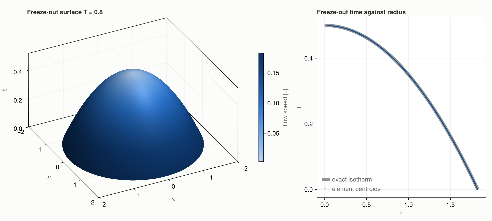

# SimplicialFreezeOut.jl

Finds the freeze-out hypersurface `T = Tfo` of a relativistic hydrodynamics
run on a Cartesian spacetime grid, as a mesh of oriented, flat surface
simplices with the fluid fields interpolated onto them, or merged into one
surface element per cell like Cornelius. Works in 1+1, 2+1 and
3+1 dimensions (and any `D ≥ 2`), on a stored spacetime array or streamed
from two consecutive time slices of a running hydro code.

The method is the simplicial one: every grid cell is cut into `D!` simplices
(Kuhn–Freudenthal subdivision), inside each simplex the temperature is affine
and its isotherm is a flat piece, and the pieces of all cells join into a
watertight mesh. Each output simplex or element carries the integrated area covector
`dΣ_μ` for Cooper–Frye integrals, its centroid, and the fields at the
centroid.



## Install and test

SimplicialFreezeOut is a Julia package. Add it to your environment from the
repository, or from a local clone with `Pkg.develop`:

```julia
using Pkg
Pkg.add(url="https://github.com/fafafrens/simplicial-freezeout")   # or Pkg.develop(path="path/to/clone")
```

Run the tests from a clone:

```bash
julia --project=. -e 'using Pkg; Pkg.test()'
```

Dependencies: StaticArrays.jl and Combinatorics.jl.

The examples, including the figure above, have their own environment because
they also use CairoMakie; it loads the package from the parent folder
(this needs Julia 1.11 or later):

```bash
julia --project=examples -e 'using Pkg; Pkg.instantiate()'   # once
julia --project=examples examples/example.jl
```

## Usage

```julia
using SimplicialFreezeOut
```

**One cell.** The extraction works on one grid cell at a time and takes one
input, a `Cell`: the cell's geometry, its `2^D` corner temperatures and,
optionally, the corner values of the fields. Using the package is a matter
of building the cell.

```julia
cell = Cell(T, (t, x, y), I; fields=(ux=ux, uy=uy))                    # cell I of a stored grid
cell = Cell(temperature, (u_prev, u), (t_prev, t), (x, y), I;          # between two time slices:
            fields=(ux = s -> s.ux, uy = s -> s.uy))                   #   functions of the hydro state
cell = Cell(origin, width, cornerT; fields=(ux=cornerux, uy=corneruy)) # by hand, from corner values

ref = ReferenceGrid(Val(3))                                # once; reused for every cell
simplices = surface_simplices(cell, Tfo; reference=ref)
e = surface_element(cell, Tfo; reference=ref)              # the same, merged into one element
```

The caller decides how the fields come back, by the container they are in:

| `fields` | result |
|---|---|
| NamedTuple, `(ux=…, uy=…)` | `e.fields.ux`, `e.fields.uy` |
| tuple, `(…, …)` | `e.fields[1]`, `e.fields[2]` |
| vector of any length, `[…, …, …]` | written into an array by `surface_element!`, see "Many fields" |

The values of a field may be numbers or static vectors, e.g. `SVector(ux, uy)`
at each corner, which interpolates several components in one pass. The grid
functions below are the loop over all cells of a stored array.

**A stored spacetime grid.** `T` is a `D`-dimensional array, time first;
`coords` the coordinate vectors, which may be non-uniform; `fields` any
arrays of the same shape.

```julia
simplices = grid_simplices(T, (t, x, y), Tfo; fields=(ux=ux, uy=uy))
e = simplices[1]
e.vertices    # the D points of the simplex (a triangle in 2+1D)
e.dsigma      # integrated area covector dΣ_μ, pointing from hot to cold
e.centroid
e.fields.ux   # linearly interpolated at the centroid
flux = integrate_surface(simplices, e -> J[1]*e.dsigma[1] + J[2]*e.dsigma[2] + J[3]*e.dsigma[3])
```

**Streaming from a hydro code.** Keep the previous and current time slices
and loop over spatial cells. The `Cell` between the two slices takes a
function of the hydro state for the temperature (the equation of state) and
one for each field.

```julia
ref = ReferenceGrid(Val(3))                       # once; reused for every cell
out = simplex_type(3, (:ux,))[]                   # collects simplices of all steps
for each time step (t_prev → t)
    for I in CartesianIndices(size(u) .- 1)
        cell = Cell(temperature, (u_prev, u), (t_prev, t), (x, y), I; fields=(ux = s -> s.ux,))
        surface_simplices!(out, cell, Tfo; reference=ref)
    end
end
```

**Integrals on the fly, without storing the surface.** The base form of
`surface_simplices` is a fold over the simplices of a cell, like `foldl`: the
running value is replaced by `f(acc, s)` for each simplex `s` and returned.
With `reference` passed it allocates nothing; without it, every call rebuilds
the reference grid, which costs more than the cell itself.

```julia
flux = surface_simplices((acc, e) -> acc + dot(J, e.dsigma), 0.0, cell, Tfo; reference=ref)

# a Cooper–Frye spectrum accumulated into an array, one cell at a time
surface_simplices(spectrum, cell, Tfo; reference=ref) do S, e
    for (k, p) in enumerate(momenta)
        S[k] += pdotdΣ(p, e.dsigma) * f(pdotu(p, velocity(e.fields)) / Tfo)
    end
    S
end
```

The other forms are special cases: `surface_simplices(f, cell, Tfo)`
calls `f(s)` for each simplex, `surface_simplices!(vector, cell, Tfo)` pushes
onto a vector, `surface_simplices(cell, Tfo)` returns a fresh one.

**One element per cell, or per block of cells.** A cell crossed by the
surface holds about 30 simplices in 3+1D. `surface_element` merges them into
one `SurfaceElement`, like the element Cornelius returns per cell:
`dsigma` is their summed area covector, `area` the sum of their areas, and
`centroid` and `fields` are area-weighted means. On a grid,
`surface_elements` returns one element per crossed cell.

```julia
elements = surface_elements(T, (t, x, y), Tfo; fields=(ux=ux, uy=uy))   # one per cell
e = surface_element(cell, Tfo; reference=ref)                           # one cell; iszero(e) if not crossed

# a block of cells, here 4 cells in time, merged into one element: add the cells one at a time
B = CartesianIndices((1:4, 10:10, 7:7))
e = foldl(B; init=zero(element_type(3, (:ux, :uy)))) do acc, I
    surface_element(acc, Cell(T, (t, x, y), I; fields=(ux=ux, uy=uy)), Tfo; reference=ref)
end
```

Merging keeps the total `dΣ_μ` exactly and reproduces affine fields at the
merged centroid; the quadrature error grows like the square of the block
width. Fields are averaged component by component, so rebuild nonlinear
quantities from the averages, e.g. `u⁰` from averaged spatial components.
`merge_element` is the fold step, and merging is associative: elements can
be merged again, e.g. `foldl(merge_element, elements; init=zero(eltype(elements)))`,
or cell by cell while streaming with `surface_element(acc, cell, Tfo)`.
`flatness(e)` is 1 for a flat element and lower for a curved one, so it
tells whether a block was small enough to merge.

**Many fields.** In a NamedTuple or a tuple, every field is an entry carried
by each element, which suits a few fields. For many, put them in a vector
and use the in-place forms: the elements come back without fields, and the
values are written into an array.

```julia
elements = element_type(4)[]
values = Float64[]
surface_elements!(elements, values, T, (t, x, y, z), Tfo, [ux, uy, uz, pixx, pixy])   # any number of arrays
F = reshape(values, 5, :)                  # F[k, j] is field k on element j

out = zeros(5); work = zeros(2^4)          # one cell: out[k] is field k on the element
cell = Cell(T, (t, x, y, z), I; fields=[ux, uy, uz, pixx, pixy])
e = surface_element!(out, cell, Tfo; reference=ref, weights=work)
```

The values are the same area-weighted means as in a NamedTuple or a tuple.
The cell's simplices are merged once into the weights of the cell's corners,
and each field is then one weighted sum over the corners, so the cost hardly
grows with the number of fields; it pays off from about half a dozen fields on.
`corner_weights(Val(D))`, passed as a field, returns these weights.

**Choosing the resolution.** Decimation thins the input grid; merging
combines the output. A sensible order:

1. Extract every few hydro steps, so the time step is about the spatial
   cell size. Hydro steps are set by stability and usually resolve the
   temperature far better in time than the grid does in space.
2. Merge per cell with `surface_elements` for Cooper–Frye. It cuts the output
   about thirtyfold in 3+1D, and the error it adds is well below that of the grid itself.
3. If that is still too many elements, merge blocks of cells as above
   rather than decimating the spatial grid. The geometry then still comes
   from the full grid, so small hot spots cannot fall between coarse grid points.

## Conventions

- Axis 1 is time. A cell's corners are numbered like the linear index of a
  `2×…×2` array, so the corner values given to `Cell` by hand may be such an
  array, a view, or a flat tuple. `cell_corners` and `slab_corners` read them
  from grid arrays; the `Cell` constructors use them.
- A vertex with `T ≥ Tfo` counts as hot. `dΣ_μ` points from hot to cold.
- `dΣ_μ` is the coordinate covector with no metric factor: in Milne
  coordinates multiply by `τ` at the centroid (`integrate_surface` takes a
  `measure` keyword for this), and apply the Minkowski signs in your
  contraction.
- Grid nodes exactly at `Tfo` are handled: the zero-area pieces they create
  are dropped and the mesh stays watertight. Extended plateaus at exactly
  `Tfo` are not supported.
- Fields are interpolated with the same affine weights as the geometry, so an
  affine field is reproduced exactly at the centroid.

## How it works

1. `ReferenceGrid(Val(D))` builds, once per dimension, the `D!` reference
   simplices (staircases through the unit cell) and a table with one entry
   per hot/cold pattern of a simplex's `D+1` vertices, listing which edges
   the isotherm crosses and how the crossing points are joined into
   `(D-1)`-simplices. The 2-vs-2 and 2-vs-3 cuts are triangulated by
   staircases too, which is what makes neighbouring simplices agree on
   shared faces. The edges of each piece are stored in the order that makes
   it point from hot to cold. Since the temperature is affine in a simplex,
   that order depends only on the pattern and on whether the simplex is
   left- or right-handed, so no orientation test is needed per cell.
2. For each cell, cells the level does not reach are rejected by a min/max
   test; otherwise each simplex looks up its pattern and builds its pieces:
   crossing points by linear interpolation along the edges, area covector as
   a generalized cross product, and fields at the centroid as the mean of
   their values at the crossing points.

Output simplices are segments for `D=2`, triangles for `D=3`, tetrahedra for
`D=4`. Do not confuse them with the input simplices: in `D=3` the input
tetrahedra produce triangles, in `D=4` the input 4-simplices produce
tetrahedra.

## Tests and comparison with Cornelius

`test/runtests.jl` checks planar isotherms analytically, a
closed spherical isotherm for watertightness, orientation and the divergence
theorem, the single-cell API, streaming from two time slices, the fold
forms, merged elements, and the in-place forms for many fields.

`benchmark/compare_cornelius.jl` runs Cornelius (P. Huovinen and H. Petersen,
arXiv:1206.3371) and this module on the same 4D fields. The Cornelius source
is not included: put `cornelius.f90` next to the script and it is compiled
with gfortran on first use.

On the spherical isotherm of `T = 1 - Σx²` the two agree to machine
precision, cell by cell. That field is a sum of one-variable functions, so
it is affine inside every cell and both methods cut each cell with the same
plane. On a Gaussian with a cross term, which is not affine inside cells,
the per-cell elements differ by about 0.7% on a 41⁴ grid. They are two
different discretizations of the same surface, accurate to second order in
the grid spacing `h`, and converge to the same surface integrals:

| `h` | Cornelius | `surface_elements` | `grid_simplices` |
|---|---|---|---|
| 0.05 | 6.0e-3 | 5.3e-3 | 4.9e-3 |
| 0.025 | 1.5e-3 | 1.3e-3 | 1.2e-3 |

The table gives the relative error of a smooth surface integral of `dΣ₀`
against its extrapolation to `h → 0`. Merged elements are as many as
Cornelius elements, one per crossing cell, and take about as long to
extract; timings on the 41⁴ grid on one core of an Apple M4 Max:

| | elements | time |
|---|---|---|
| Cornelius | 95,448 | 0.14 s |
| `surface_elements` | 95,448 | 0.13 s |
| `grid_simplices` | 2,944,344 | 0.19 s |

## Files

- `src/SimplicialFreezeOut.jl`: the module, with docstrings carrying worked examples.
- `test/runtests.jl`: the test suite, run by `Pkg.test()`.
- `examples/example.jl`: runnable examples of a stored grid, a single cell,
  streaming from two time slices, integrals on the fly with the fold, and
  merged elements per cell and per block of cells, ending with the figure
  `examples/freezeout_surface.png`.
- `benchmark/compare_cornelius.jl`: the comparison with Cornelius, run with
  `julia --project=. benchmark/compare_cornelius.jl`.
- `geometry_rectangle.png`, `geometry_tetrahedron.png`: figures of the
  reference simplices and an isothermal cut in 1+1D and 2+1D.
