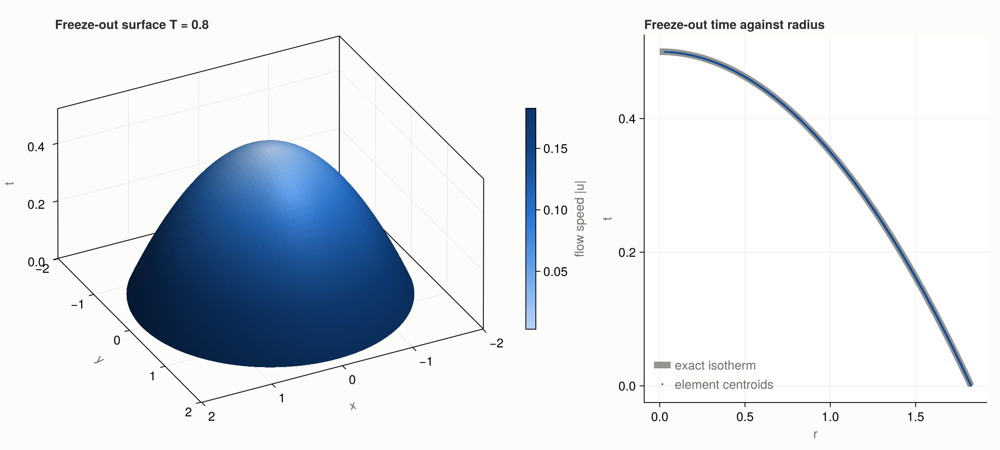

# SimplicialFreezeOut.jl

Finds the freeze-out hypersurface `T = Tfo` of a relativistic hydrodynamics
run on a Cartesian spacetime grid, as a mesh of oriented, flat surface
elements with the fluid fields interpolated onto them. Works in 1+1, 2+1 and
3+1 dimensions (and any `D ≥ 2`), on a stored spacetime array or streamed
from two consecutive time slices of a running hydro code.

The method is the simplicial one: every grid cell is cut into `D!` simplices
(Kuhn–Freudenthal subdivision), inside each simplex the temperature is affine
and its isotherm is a flat piece, and the pieces of all cells join into a
watertight mesh. Each output element carries the integrated area covector
`dΣ_μ` for Cooper–Frye integrals, its centroid, and the fields at the
centroid.



## Install and test

```bash
julia --project=. -e 'using Pkg; Pkg.instantiate()'   # once
julia --project=. test_simplicial_freezeout.jl
```

Dependencies: StaticArrays.jl and Combinatorics.jl.

The examples, including the figure above, have their own environment because
they also use CairoMakie:

```bash
julia --project=examples -e 'using Pkg; Pkg.instantiate()'   # once
julia --project=examples examples/example.jl
```

## Usage

```julia
include("SimplicialFreezeOut.jl")
using .SimplicialFreezeOut
```

**A stored spacetime grid.** `T` is a `D`-dimensional array, time first;
`coords` the coordinate vectors, which may be non-uniform; `fields` any
arrays of the same shape.

```julia
surface = isosurface(T, (t, x, y), Tfo; fields=(ux=ux, uy=uy))
e = surface[1]
e.vertices    # the D points of the piece (a triangle in 2+1D)
e.dsigma      # integrated area covector dΣ_μ, pointing from hot to cold
e.centroid
e.fields.ux   # linearly interpolated at the centroid
flux = integrate_surface(surface, e -> J[1]*e.dsigma[1] + J[2]*e.dsigma[2] + J[3]*e.dsigma[3])
```

**Streaming from a hydro code.** Keep the previous and current time slices
and loop over spatial cells. `slab_corners` gathers the `2^D` corner values
of a cell from the two slices, applying a function to each grid value (the
equation of state, or a field accessor); `Cell` gives the cell geometry.

```julia
ref = ReferenceGrid(Val(3))                       # once; reused for every cell
out = element_vector(Val(3), (ux=nothing,))       # collects elements of all steps
for each time step (t_prev → t)
    for I in CartesianIndices(size(u) .- 1)
        cell_isosurface!(out, slab_corners(temperature, u_prev, u, I),
                         Cell((t_prev, t), (x, y), I), Tfo;
                         fields=(ux=slab_corners(v -> v.ux, u_prev, u, I),), reference=ref)
    end
end
```

**Integrals on the fly, without storing the surface.** The base form of
`cell_isosurface` is a fold over the pieces of a cell, like `foldl`: the
running value is replaced by `f(acc, element)` for each piece and returned.
It allocates nothing.

```julia
flux = cell_isosurface((acc, e) -> acc + dot(J, e.dsigma), 0.0, cornerT, cell, Tfo; reference=ref)

# a Cooper–Frye spectrum accumulated into an array, one cell at a time
cell_isosurface(spectrum, cornerT, cell, Tfo; fields, reference=ref) do S, e
    for (k, p) in enumerate(momenta)
        S[k] += pdotdΣ(p, e.dsigma) * f(pdotu(p, velocity(e.fields)) / Tfo)
    end
    S
end
```

The other forms are special cases: `cell_isosurface(f, cornerT, cell, Tfo)`
calls `f(element)` for each piece, `cell_isosurface!(vector, ...)` pushes
onto a vector, `cell_isosurface(cornerT, cell, Tfo)` returns a fresh one.

## Conventions

- Axis 1 is time. A cell's corners are numbered like the linear index of a
  `2×…×2` array, so `cornerT` may be such an array, a view, or a flat tuple.
- A vertex with `T ≥ Tfo` counts as hot. `dΣ_μ` points from hot to cold.
- `dΣ_μ` is the coordinate covector with no metric factor: in Milne
  coordinates multiply by `τ` at the centroid (`integrate_surface` takes a
  `measure` keyword for this), and apply the Minkowski signs in your
  contraction.
- Grid nodes exactly at `Tfo` are handled: the zero-area pieces they create
  are dropped and the mesh stays watertight. Extended plateaus at exactly
  `Tfo` are not supported.
- Fields are interpolated with the same affine weights as the geometry, so an
  affine field is reproduced exactly at the centroid.

## How it works

1. `ReferenceGrid(Val(D))` builds, once per dimension, the `D!` reference
   simplices (staircases through the unit cell) and a table with one entry
   per hot/cold pattern of a simplex's `D+1` vertices, listing which edges
   the isotherm crosses and how the crossing points are joined into
   `(D-1)`-simplices. The 2-vs-2 and 2-vs-3 cuts are triangulated by
   staircases too, which is what makes neighbouring simplices agree on
   shared faces.
2. For each cell, cells the level does not reach are rejected by a min/max
   test; otherwise each simplex looks up its pattern and builds its pieces:
   crossing points by linear interpolation along the edges, area covector as
   a generalized cross product, orientation toward the coldest vertex, fields
   from the barycentric weights of the centroid.

Output elements are segments for `D=2`, triangles for `D=3`, tetrahedra for
`D=4`. Do not confuse them with the input simplices: in `D=3` the input
tetrahedra produce triangles, in `D=4` the input 4-simplices produce
tetrahedra.

## Tests and comparison with Cornelius

`test_simplicial_freezeout.jl` checks planar isotherms analytically, a
closed spherical isotherm for watertightness, orientation and the divergence
theorem, the single-cell API, streaming from two time slices, and the fold
forms.

`compare_cornelius.jl` runs Cornelius (P. Huovinen and H. Petersen,
arXiv:1206.3371) and this module on the same 4D field. The Cornelius source
is not included: put `cornelius.f90` next to the script and it is compiled
with gfortran on first use. On a spherical isotherm both give the same
integrated `dΣ_μ` and enclosed volume to all printed digits. Cornelius
returns one merged element per crossing cell and extracts about twice as
fast; this module returns the roughly 30 tetrahedra per cell individually,
and the fold lets you merge them per cell if you want Cornelius-sized output.

## Files

- `SimplicialFreezeOut.jl`: the module, with docstrings carrying worked examples.
- `examples/example.jl`: runnable examples of a stored grid, a single cell,
  streaming from two time slices, and integrals on the fly with the fold,
  ending with the figure `examples/freezeout_surface.png`.
- `test_simplicial_freezeout.jl`, `compare_cornelius.jl`: see above.
- `geometry_rectangle.png`, `geometry_tetrahedron.png`: figures of the
  reference simplices and an isothermal cut in 1+1D and 2+1D.
